<!-- Generated by scripts/github-profile.mjs in the portfolio repo. Edit it there. -->

<a href="https://jonathanrashi.xyz"><picture><source media="(max-width: 640px)" srcset="assets/sm-nav-logo.svg"></picture></a><a href="https://jonathanrashi.xyz/#work"><picture><source media="(max-width: 640px)" srcset="assets/sm-nav-work.svg"></picture></a><a href="https://jonathanrashi.xyz/#notes"><picture><source media="(max-width: 640px)" srcset="assets/sm-nav-notes.svg"></picture></a><a href="https://jonathanrashi.xyz/about"><picture><source media="(max-width: 640px)" srcset="assets/sm-nav-about.svg"></picture></a><a href="https://jonathanrashi.xyz/#contact"><picture><source media="(max-width: 640px)" srcset="assets/sm-nav-available.svg"></picture></a><a href="mailto:jonathanrashi100@gmail.com"><picture><source media="(max-width: 640px)" srcset="assets/sm-nav-email.svg"></picture></a><a href="https://cal.com/jonathanrashi/30min"><picture><source media="(max-width: 640px)" srcset="assets/sm-nav-call.svg"></picture></a> 
<a href="https://jonathanrashi.xyz"><picture><source media="(max-width: 640px)" srcset="assets/sm-hero.svg"></picture></a> 
<a href="https://jonathanrashi.xyz/about"><picture><source media="(max-width: 640px)" srcset="assets/sm-readme.svg"></picture></a> 
<a href="https://jonathanrashi.xyz/#contact"><picture><source media="(max-width: 640px)" srcset="assets/sm-contact.svg"></picture></a> 
<a href="https://cal.com/jonathanrashi/30min"><picture><source media="(max-width: 640px)" srcset="assets/sm-cta-call.svg"></picture></a><a href="mailto:jonathanrashi100@gmail.com"><picture><source media="(max-width: 640px)" srcset="assets/sm-cta-email.svg"></picture></a><a href="https://jonathanrashi.xyz"><picture><source media="(max-width: 640px)" srcset="assets/sm-cta-site.svg"></picture></a> 
<a href="https://jonathanrashi.xyz"><picture><source media="(max-width: 640px)" srcset="assets/sm-foot.svg"></picture></a>

